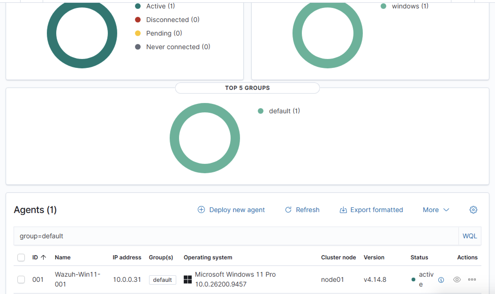
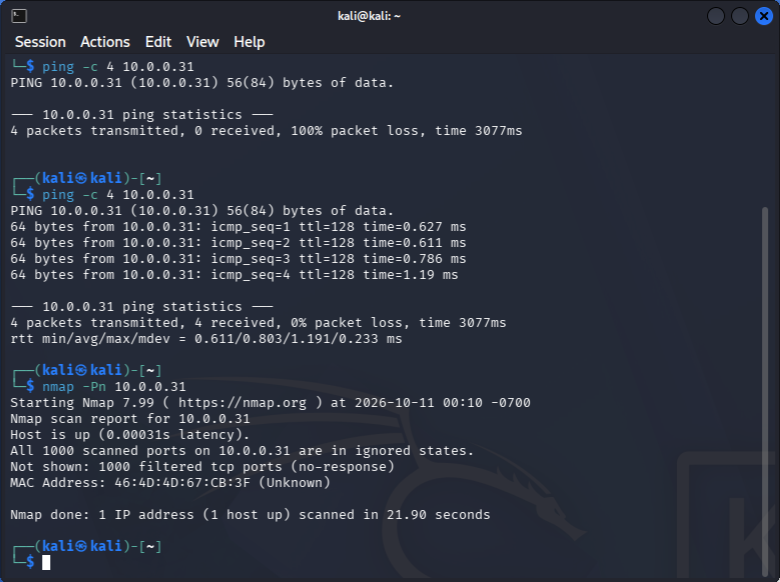
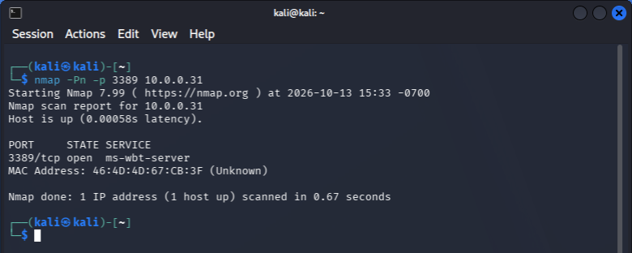
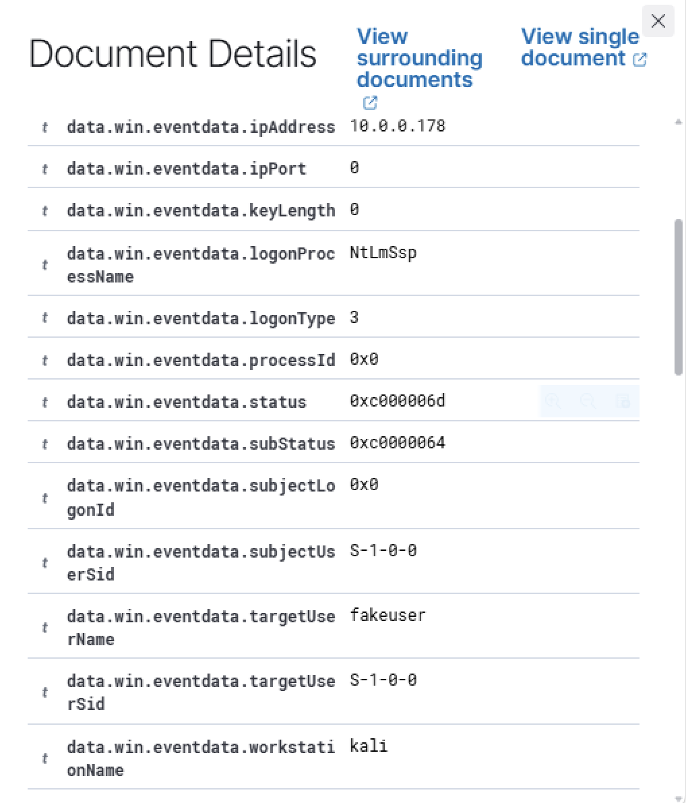
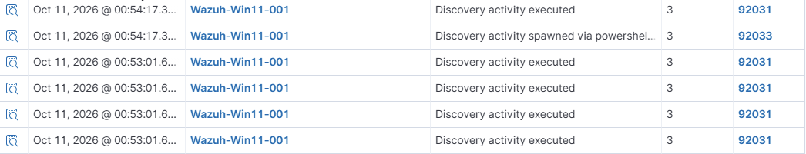

# Home SOC Lab — Wazuh SIEM on Apple Silicon

A self-built Security Operations Center (SOC) lab running on one Apple Silicon MacBook Air with UTM. The goal is to attack a Windows endpoint from Kali Linux and detect it with an open-source SIEM, the same workflow a SOC analyst uses on the job.

> **Status:** Phase 1 complete: SIEM deployed, Windows endpoint monitored, Sysmon added, first detections confirmed. Phase 2 (RDP brute force with Hydra) is next.

---

## Lab Architecture

| VM | OS | Role | IP |
|---|---|---|---|
| `siemlog` | Ubuntu Server, ARM64, headless <!-- add version: run `lsb_release -a` --> | Wazuh SIEM (manager, indexer, dashboard) | 10.0.0.136 (static) |
| `Wazuh-Win11-001` | Windows 11 Pro, ARM64 | Victim endpoint: Wazuh agent + Sysmon | 10.0.0.31 |
| Kali | Kali Linux, ARM64 | Attacker | 10.0.0.178 (DHCP) |

- **Host:** Apple Silicon MacBook Air, 24 GB RAM, running UTM
- **Network:** all three VMs bridged to the host's Wi-Fi so they can reach each other
- **Wazuh server resources:** 4 vCPU, 8 GB RAM, 50 GB disk

<!-- Optional: add screenshots/network-diagram.png here -->

---

## Build Log

### Step 1: Wazuh server
- Created an Ubuntu Server VM in UTM. I chose the server edition over desktop because a GUI would take RAM the Wazuh indexer needs, and production SIEMs run headless anyway.
- Used UTM's Shared Network during install, then switched to Bridged (see Step 3).
- Updated the system (`apt update` / `apt upgrade`), then ran the Wazuh 4.14 all-in-one installer:
  ```bash
  curl -sO https://packages.wazuh.com/4.14/wazuh-install.sh
  sudo bash ./wazuh-install.sh -a
  ```
- Logged in to the web dashboard from a browser on another machine.

### Step 2: Network design
- Researched UTM's network modes. UTM's docs describe Shared Network as guest↔host only, and a UTM GitHub issue confirms VMs on Shared Network can fail to reach each other.
- Moved the Wazuh server and the Windows VM to **Bridged** networking. Each got an address on the home LAN (`10.0.0.0/24`).
- Gave the Wazuh server a **static IP** with netplan, because agents connect by IP and a DHCP change would cut them off. See [`configs/netplan-static-ip.yaml`](configs/netplan-static-ip.yaml).

### Step 3: Windows endpoint + Wazuh agent
- Confirmed Windows could reach the Wazuh server's agent port before installing anything:
  ```powershell
  Test-NetConnection 10.0.0.136 -Port 1514   # TcpTestSucceeded : True
  ```
- Deployed the agent with the dashboard's **Deploy new agent** wizard (Windows MSI), ran the generated command in an admin PowerShell, and started the service with `NET START WazuhSvc`.
- The agent `Wazuh-Win11-001` showed **Active**.



**Finding: CIS benchmark.** On enrollment, Wazuh's Security Configuration Assessment ran the **CIS Windows 11 Enterprise** policy: 482 checks. The default install scored **26%**.

<!-- screenshots/sca-score.png -->

### Step 4: Attacker VM + reconnaissance
- Bridged the Kali VM onto the same network.
- Windows Firewall blocks inbound ping by default, so I added a rule allowing ICMP echo for lab testing.
- Scanned the victim from Kali:
  ```bash
  nmap -Pn 10.0.0.31
  ```
  **Result:** all 1000 ports **filtered**. The default Windows Firewall dropped all unsolicited inbound traffic.

**Finding: Wazuh doesn't see the scan.** Wazuh works from host logs, and Windows doesn't log a blocked scan, so no alerts appeared. Network-level detection needs a tool like Suricata.



### Step 5: Detection #1, failed RDP logins
- Turned on Remote Desktop to expose a realistic attack surface.
- The port still showed **filtered** and nothing was listening on 3389 (`netstat -an | findstr 3389` was empty), even though Settings showed RDP **On**. I checked the `fDenyTSConnections` registry value and rebooted, after which port 3389 was **listening**, and nmap from Kali showed `3389/tcp open`.

  

- From Kali, sent repeated RDP logins with a fake user and a wrong password:
  ```bash
  xfreerdp3 /v:10.0.0.31 /u:fakeuser /p:wrongpass /cert:ignore
  ```
- In Wazuh Threat Hunting, searched `data.win.system.eventID:4625` (Windows failed logon).
- **Result:** Wazuh alerted on each attempt with **"Logon failure – Unknown user or bad password"**.
- MITRE ATT&CK: T1110, Brute Force (attempted)

**Evidence from the alert:**

| Field | Value | Meaning |
|---|---|---|
| `ipAddress` | 10.0.0.178 | Source of the attempt: the Kali VM |
| `workstationName` | kali | Attacker's hostname |
| `targetUserName` | fakeuser | Account the attacker tried |
| `logonType` | 3 | Network logon (RDP with Network Level Authentication checks credentials this way) |
| `status` / `subStatus` | 0xC000006D / 0xC0000064 | Logon failed / **username does not exist** |



### Step 6: Sysmon telemetry
- Installed Sysmon with the [SwiftOnSecurity config](https://github.com/SwiftOnSecurity/sysmon-config). Windows on ARM needs the ARM64 build, `Sysmon64a.exe`:
  ```powershell
  .\Sysmon64a.exe -accepteula -i sysmonconfig.xml
  ```
- The Wazuh agent doesn't collect Sysmon logs by default, so I added the Sysmon event channel to the agent config and restarted the agent. See [`configs/ossec-sysmon-snippet.xml`](configs/ossec-sysmon-snippet.xml).

### Step 7: Detection #2, discovery commands
- Ran common post-access reconnaissance commands on Windows:
  ```powershell
  whoami /priv
  net user
  ```
- Searched `rule.groups:sysmon` in Wazuh. **Result:** 32 Sysmon-based alerts, including:
  - **Rule 92031:** Discovery activity executed
  - **Rule 92033:** Discovery activity spawned via PowerShell



---

## Troubleshooting & Lessons Learned

| Problem | Cause | Fix |
|---|---|---|
| VMs on Shared Network not reliably reaching each other | UTM Shared Network is built for VM↔host traffic | Switched to Bridged |
| Dashboard unreachable | Ubuntu VM was powered off; the dashboard runs on it | Boot the server first and allow 1–2 minutes for services |
| Ping to Windows: 100% loss | Windows Firewall blocks inbound ICMP | Added an inbound ICMPv4 echo rule |
| RDP "On" but port 3389 filtered/not listening | Setting hadn't applied | Checked `fDenyTSConnections`, rebooted, confirmed with `netstat` |
---

## Roadmap

- [x] Deploy Wazuh SIEM
- [x] Enroll Windows endpoint
- [x] Reconnaissance from Kali
- [x] Detect failed RDP logins (Event 4625)
- [x] Add Sysmon telemetry + detect discovery commands
- [ ] RDP brute force with Hydra: detect failures followed by a success
- [ ] Post-exploitation simulation: new admin user, persistence, encoded PowerShell
- [ ] Custom Wazuh detection rule
- [ ] Active response: auto-block the attacker IP
- [ ] Suricata for network-level detection
- [ ] Incident report for each scenario

---

## Disclaimer

All activity was done in a personal lab against machines I own. Don't use these techniques on systems without explicit authorization.
